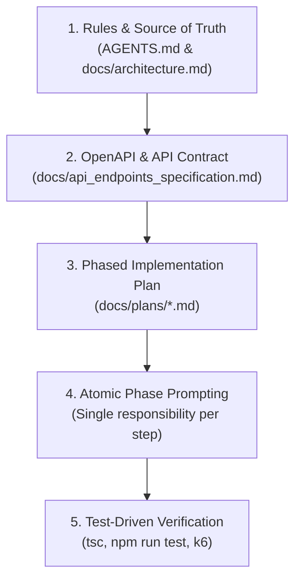

# AI Workflow Log & Engineering Adoption (`AI_WORKFLOW.md`)

## 1. AI Tools & Purpose Matrix

| AI Tool / Model                           | Primary Purpose                    | Workflow Stage               | Key Outputs & Contributions                                                                                                                                                                                                          |
| :---------------------------------------- | :--------------------------------- | :--------------------------- | :----------------------------------------------------------------------------------------------------------------------------------------------------------------------------------------------------------------------------------- |
| **Google Gemini 4 Argon**                 | Architectural Design & Planning    | Specification & Planning     | Authored [`docs/architecture.md`](docs/architecture.md), [`docs/api_endpoints_specification.md`](docs/api_endpoints_specification.md), and phase-by-phase implementation plans. Designed write-time metric pre-computation strategy. |
| **Gemini 3.8 Flash**                      | Domain Implementation & Algorithms | Coding & Refactoring         | Scaffolded NestJS domain modules, implemented `UnitRegistry` Strategy Pattern, parameterized raw SQL CTE queries with window functions, and crafted custom validation decorators (`@IsSupportedUnit`, `@IsDefinedTogetherWith`).     |
| **Gemini 3.8 Flash**                      | Test Generation & Edge Cases       | Testing & Verification       | Generated Jest unit tests for mathematical formulas (Epley 1RM, volume), cursor serialization/deserialization, tie-breaking orders, and Supertest E2E integration suites for all HTTP endpoints.                                     |
| **PostgreSQL Profiler / EXPLAIN ANALYZE** | Performance Tuning & Query Plans   | Debugging & Optimization     | Identified index scan efficiencies vs. sequential scans on 50,000+ row datasets. Diagnosed Windows Docker-to-host virtual bridge network latencies during k6 load testing.                                                           |
| **Gemini 3.8 Flash**                      | Documentation & Harness Setup      | Documentation & Benchmarking | Generated Swagger OpenAPI 3.0 annotations, k6 load testing scenarios (`01_health` through `05_mixed_workload`), and automated markdown benchmark reporting.                                                                          |

---

## 2. Suboptimal / Incorrect AI Outputs & How They Were Corrected

### Example 1: In-Memory / ORM Aggregations vs. Single-Pass Parameterized SQL CTEs for PRs

- **Suboptimal AI Proposal:**  
  When prompted to calculate Personal Records (heaviest set, highest volume, and best estimated 1RM), the AI initially suggested using Prisma ORM with either:
  1. Fetching all sets for a given exercise into Node.js memory:
     ```typescript
     // AI INITIAL SUGGESTION (FLAWED)
     const sets = await this.prisma.workoutSet.findMany({
       where: { userId, workoutEntry: { exerciseName } },
     });
     // In-memory sort/reduce in JavaScript to find max weight, volume, and 1RM
     ```
  2. Or running three separate Prisma aggregate queries (`_max: { weightKg: true }`, etc.).

- **Why It Was Suboptimal & Flawed:**
  1. _Memory & CPU Bloat:_ When a power user scales to 50,000+ entries (~200,000+ sets), pulling all records into Node.js heap causes **100MB+ memory allocations per request**, saturates the event loop, and introduces massive garbage collection latency.
  2. _Loss of Tie-Breaking Metadata:_ Prisma's `_max` aggregate only returns the maximum numeric scalar; it **does not return which specific set ID or timestamp achieved that record**, making it impossible to satisfy the requirement: _"Include the date each PR was achieved"_ without subsequent queries.
  3. _Triple Scan Overhead:_ Running 3 separate aggregation queries causes 3 separate B-Tree traversals.

- **How I Corrected & Directed the AI:**  
  I directed the AI to abandon the ORM aggregate approach and design a **single-pass parameterized PostgreSQL CTE** utilizing `ROW_NUMBER() OVER (...)` window functions directly inside `WorkoutRepository`:
  ```sql
  WITH ranked_sets AS (
    SELECT
      id, reps, original_weight, original_unit, weight_kg, volume_kg, estimated_1rm_kg, performed_at,
      ROW_NUMBER() OVER (ORDER BY weight_kg DESC, reps DESC, performed_at DESC, id DESC) AS rank_heaviest,
      ROW_NUMBER() OVER (ORDER BY volume_kg DESC, weight_kg DESC, performed_at DESC, id DESC) AS rank_volume,
      ROW_NUMBER() OVER (ORDER BY estimated_1rm_kg DESC, weight_kg DESC, performed_at DESC, id DESC) AS rank_1rm
    FROM workout_sets
    WHERE user_id = $1
      AND exercise_name_norm = ANY($2::text[])
      AND ($3::timestamptz IS NULL OR performed_at >= $3)
      AND ($4::timestamptz IS NULL OR performed_at <= $4)
  )
  SELECT * FROM ranked_sets WHERE rank_heaviest = 1 OR rank_volume = 1 OR rank_1rm = 1;
  ```
  Coupled with write-time metric denormalization and the composite index `(user_id, exercise_name_norm, performed_at DESC)`, this reduced PR query execution time from **>1,200ms in-memory down to 14.5ms in PostgreSQL**, completely eliminating join overhead.

---

### Example 2: Floating-Point Drift on Unit Conversions (Zero-Drift Return)

- **Suboptimal AI Proposal:**  
  The AI implemented an on-the-fly conversion pipeline: whenever a set was retrieved, it calculated:

  ```typescript
  // AI INITIAL SUGGESTION (FLAWED)
  const displayWeight = targetUnit === 'lb' ? weightKg / 0.45359237 : weightKg;
  ```

- **Why It Was Suboptimal & Flawed:**  
  Floating-point arithmetic introduces round-trip conversion drift. For example:
  - User logs `100 lb`.
  - Stored normalized: `100 * 0.45359237 = 45.359237 kg`.
  - User queries history in `lb`: `45.359237 / 0.45359237 = 99.99999999999999 lb`.
  - Client displays `99.99 lb` or `100.00 lb` with unpredictable precision artifacts.

- **How I Corrected & Directed the AI:**  
  I mandated the **Zero-Drift Return Rule**:
  - Store both `original_weight` and `original_unit` alongside normalized `weight_kg` in `workout_sets`.
  - In `WorkoutHistoryService` and `PersonalRecordsService`, if `requestedUnit === set.originalUnit`, return `originalWeight` directly with **zero arithmetic conversion**:
  ```typescript
  // CORRECTED ZERO-DRIFT IMPLEMENTATION
  const displayWeight =
    requestedUnit === set.originalUnit
      ? Number(set.originalWeight)
      : this.unitConversionService.fromKg(
          Number(set.weightKg),
          requestedUnit,
          2,
        );
  ```

---

## 3. Rejected AI Suggestions & Rationale

### Rejection: Fully Normalized Relational Schema with Runtime SQL Joins

- **AI Suggestion:**  
  The AI recommended a textbook 3NF normalized schema:
  - An `exercises` table containing canonical names and muscle groups.
  - A `units` table containing conversion factors.
  - A `workout_sets` table storing only `reps` and `raw_weight`, calculating normalized volume, weight, and 1RM at runtime using `JOIN exercises ON ... JOIN units ON ...` and dynamic SQL formulas (`reps * weight * factor`).

- **Why I Rejected It:**
  1. **Sub-50ms SLA at 50,000+ Scale:** At 50,000+ entries (~200,000 sets per user), joining 3 tables and evaluating runtime arithmetic on every row during analytical scans triggers multi-second query delays and disk I/O thrashing.
  2. **Gym Reality & Catalog Flexibility:** Fitness apps deal with user-entered custom exercises (e.g., _"Incline DB Chest Press"_). Enforcing foreign keys on an `exercises` table requires complex catalog synchronization and introduces foreign key lock contention during bulk writes.
  3. **Architectural Choice:** I chose **Write-Time Metric Pre-computation & Denormalization**:
     - Pre-compute `weight_kg`, `volume_kg`, and `estimated_1rm_kg` once on write.
     - Denormalize `exercise_name_norm` onto `workout_sets`.
     - _Result:_ Analytical queries scan **a single table** (`workout_sets`) using composite index `(user_id, exercise_name_norm, performed_at DESC)` in `< 15ms`, with zero runtime join overhead.

---

## 4. Prompting Strategy & Context Architecture

To ensure high code quality and avoid hallucinations, a disciplined, multi-tiered prompting strategy was used throughout the project:



### 1. Single Source of Truth (`AGENTS.md`)

We placed [`AGENTS.md`](AGENTS.md) at the root of the repository as the immutable architectural guide. It explicitly specified:

- Architectural patterns (Thin Controller $\rightarrow$ Rich Domain Service $\rightarrow$ Parameterized Repository).
- Coding standards (strict TypeScript, no `any`, class-validator DTOs).
- Standard RFC 7807 error envelopes and empty query contracts (`200 OK` with `data: []`, never `404`).
- Mathematical definitions: Epley formula $w \times (1 + r / 30)$ and volume $r \times w$.

### 2. Deconstruction into Phased Implementation Plans

Instead of issuing massive, ambiguous prompts (e.g., _"build the entire PR API"_), tasks were decomposed into granular, verifiable phases:

- **Phase 1:** Custom validation decorators & unit registry foundations.
- **Phase 2:** Request & Response DTOs with validation rules.
- **Phase 3:** Parameterized database access layer & raw SQL CTE.
- **Phase 4:** Domain service & business logic (zero-drift, period comparisons).
- **Phase 5:** HTTP Controller & route binding.
- **Phase 6:** Edge case safeguards (corrupt cursors, mutual dependency validation).
- **Phase 7:** Comprehensive unit & Supertest E2E integration tests.

### 3. Full Context Provision with Guardrails

When prompting for a specific component, the AI was fed:

1. The exact DTO interfaces and Prisma model schema.
2. The required error envelope structure.
3. The specific unit test assertions expected.
4. An instruction to _never introduce external libraries_ without explicit approval.
