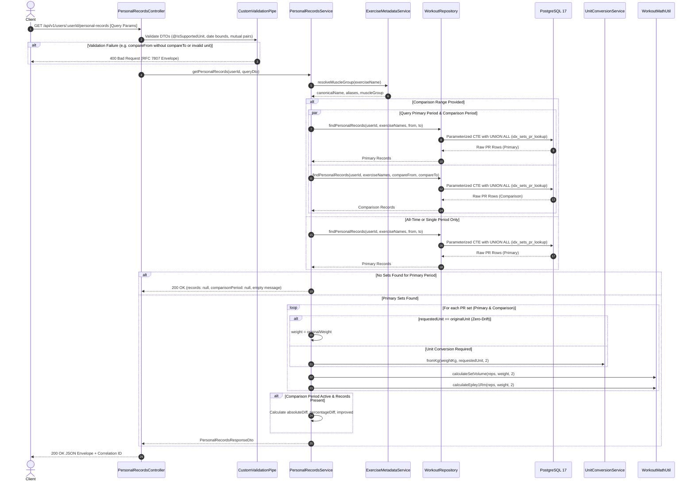

# Implementation Plan: GET /api/v1/users/:userId/personal-records

## 1. Overview & Objectives

The goal is to implement the **Get Personal Records (PRs) & Time-Range Comparison** endpoint:

- **Route:** `GET /api/v1/users/:userId/personal-records`
- **Status Code:** `200 OK`
- **Key Responsibilities:**
  1. Validate and sanitize query parameters (`exerciseName`, `unit`, `from`, `to`, `compareFrom`, `compareTo`).
  2. Enforce date constraints: validate ISO 8601 formatting, normalize date-only boundaries (`YYYY-MM-DD` expands to `00:00:00.000Z` and `23:59:59.999Z`), and verify `from <= to` as well as `compareFrom <= compareTo`.
  3. Validate mutual dependency for comparison periods: `compareFrom` and `compareTo` must be provided together. Providing only one rejects immediately with `400 Bad Request` (`VALIDATION_ERROR`).
  4. Support All-Time PR calculation when both `from` and `to` are omitted.
  5. Resolve exercise canonical names and aliases via `ExerciseMetadataService` to support seamless querying across catalog variants and synonyms.
  6. Execute a high-performance single-pass parameterized SQL CTE query on `workout_sets` leveraging the composite index `(user_id, exercise_name_norm, performed_at DESC)` with zero table join overhead.
  7. Enforce deterministic tie-breaking rules:
     - **Heaviest Set:** `weight_kg DESC, reps DESC, performed_at DESC, id DESC`
     - **Highest Volume Set:** `volume_kg DESC, weight_kg DESC, performed_at DESC, id DESC`
     - **Best Estimated 1RM:** `estimated1rm_kg DESC, weight_kg DESC, performed_at DESC, id DESC`
  8. Perform dynamic unit conversion and zero-drift return (if requested unit matches the set's `original_unit`, preserve the exact `original_weight` without floating-point conversion artifacts).
  9. Run primary and comparison periods in parallel (`Promise.all`) when comparison dates are provided, and calculate absolute difference, percentage difference, and improvement status.
  10. Adhere to the empty query rule: return `200 OK` with `records: { heaviestSet: null, highestVolumeSet: null, bestEstimated1RM: null }`, `comparisonPeriod: null`, `comparison: null`, and a descriptive message when no matching records exist (never throw `404`).
  11. Handle validation failures and unsupported units with standard RFC 7807 error envelopes (`VALIDATION_ERROR`, `UNSUPPORTED_UNIT`).

---

## 2. Architecture & Data Flow



---

## 3. Step-by-Step Implementation Breakdown

### Phase 1: Custom Mutual-Dependency Validation Decorator (`src/common/decorators/`)

- [x] **1.1 Mutual Dependency Decorator (`src/common/decorators/is-defined-together-with.decorator.ts`):**
  - Implement `@IsDefinedTogetherWith(relatedProperty: string, validationOptions?: ValidationOptions)`:
    - If property $A$ has a non-empty value, property $B$ must also have a non-empty value.
    - If validation fails, produce an issue message: `"${property} requires '${relatedProperty}' to also be specified."`.
- [x] **1.2 Export Decorator (`src/common/decorators/index.ts`):**
  - Export `IsDefinedTogetherWith` and `IS_DEFINED_TOGETHER_WITH` token.
- [x] **1.3 Unit Tests (`src/common/decorators/is-defined-together-with.decorator.spec.ts`):**
  - Verify validation passes when both properties are present.
  - Verify validation passes when both properties are omitted/undefined.
  - Verify validation fails when only one property is provided.

---

### Phase 2: DTOs & Response Contracts (`src/modules/workouts/dto/`)

- [x] **2.1 Personal Records Query DTO (`src/modules/workouts/dto/personal-records-query.dto.ts`):**
  - `exerciseName: string`:
    - Required trimmed string (`@IsNotEmpty()`, `@IsString()`, `@Length(1, 150)`).
  - `unit?: string`:
    - Optional weight unit string, validated by `@IsSupportedUnit()` (defaults to `'kg'`).
  - `from?: string`:
    - Optional ISO 8601 string normalized via `normalizeFromDate`.
    - Bounded by `@IsEarlierThanOrEqualTo('to', { message: "'from' date must be earlier than or equal to 'to' date." })`.
  - `to?: string`:
    - Optional ISO 8601 string normalized via `normalizeToDate`.
  - `compareFrom?: string`:
    - Optional ISO 8601 string normalized via `normalizeFromDate`.
    - Paired with `@IsDefinedTogetherWith('compareTo', { message: "'compareFrom' requires 'compareTo' to also be specified." })`.
    - Bounded by `@IsEarlierThanOrEqualTo('compareTo', { message: "'compareFrom' date must be earlier than or equal to 'compareTo' date." })`.
  - `compareTo?: string`:
    - Optional ISO 8601 string normalized via `normalizeToDate`.
    - Paired with `@IsDefinedTogetherWith('compareFrom', { message: "'compareTo' requires 'compareFrom' to also be specified." })`.
- [x] **2.2 Personal Records Response DTOs (`src/modules/workouts/dto/personal-records-response.dto.ts`):**
  - `HeaviestSetRecordDto`:
    - `weight: number` (display weight in target unit, 2 decimals)
    - `reps: number`
    - `unit: string`
    - `achievedAt: string` (ISO 8601 UTC)
    - `workoutEntryId: string` (UUID)
    - `setId: string` (UUID)
  - `HighestVolumeSetRecordDto`:
    - `volume: number` (display volume in target unit, 2 decimals)
    - `weight: number`
    - `reps: number`
    - `unit: string`
    - `achievedAt: string`
    - `workoutEntryId: string`
    - `setId: string`
  - `BestEstimated1RmRecordDto`:
    - `estimated1RM: number` (display 1RM in target unit, 2 decimals)
    - `weight: number`
    - `reps: number`
    - `unit: string`
    - `achievedAt: string`
    - `workoutEntryId: string`
    - `setId: string`
  - `PersonalRecordsGroupDto`:
    - `heaviestSet: HeaviestSetRecordDto | null`
    - `highestVolumeSet: HighestVolumeSetRecordDto | null`
    - `bestEstimated1RM: BestEstimated1RmRecordDto | null`
  - `PeriodRangeDto`:
    - `from: string | null`
    - `to: string | null`
  - `PeriodRecordsDto`:
    - `range: PeriodRangeDto`
    - `records: PersonalRecordsGroupDto`
  - `MetricComparisonDto`:
    - `absoluteDiff: number`
    - `percentageDiff: number`
    - `improved: boolean`
  - `PeriodComparisonDto`:
    - `heaviestSet: MetricComparisonDto | null`
    - `highestVolumeSet: MetricComparisonDto | null`
    - `bestEstimated1RM: MetricComparisonDto | null`
  - `PersonalRecordsDataDto`:
    - `userId: string`
    - `exerciseName: string`
    - `muscleGroup: string | null`
    - `unit: string`
    - `primaryPeriod: PeriodRecordsDto`
    - `comparisonPeriod: PeriodRecordsDto | null`
    - `comparison: PeriodComparisonDto | null`
  - `PersonalRecordsMetaDto`:
    - `message: string`
  - `PersonalRecordsResponseDto`:
    - `data: PersonalRecordsDataDto`
    - `meta: PersonalRecordsMetaDto`
- [x] **2.3 Export DTOs (`src/modules/workouts/dto/index.ts`):**
  - Export new query and response DTOs.

---

### Phase 3: Data Access Layer & Parameterized SQL CTE (`src/modules/workouts/repositories/`)

- [x] **3.1 Repository Interfaces (`src/modules/workouts/repositories/interfaces/workout-repository.interface.ts`):**
  - Define `RawPersonalRecordRow`:
    ```typescript
    export type PrType = 'heaviest_set' | 'highest_volume_set' | 'best_1rm_set';

    export interface RawPersonalRecordRow {
      readonly pr_type: PrType;
      readonly id: string;
      readonly workout_entry_id: string;
      readonly reps: number;
      readonly original_weight: Prisma.Decimal | number;
      readonly original_unit: string;
      readonly weight_kg: Prisma.Decimal | number;
      readonly volume_kg: Prisma.Decimal | number;
      readonly estimated_1rm_kg: Prisma.Decimal | number;
      readonly performed_at: Date;
    }
    ```
- [x] **3.2 Implement Parameterized PR CTE Query (`src/modules/workouts/repositories/workout.repository.ts`):**
  - Implement `findPersonalRecords(userId: string, exerciseNames: string[], fromDate?: Date, toDate?: Date): Promise<RawPersonalRecordRow[]>`:
    - Execute parameterized SQL query via `this.prisma.$queryRaw<RawPersonalRecordRow[]>`:
      ```sql
      WITH scoped_sets AS (
        SELECT 
          id, 
          workout_entry_id, 
          reps, 
          original_weight, 
          original_unit, 
          weight_kg, 
          volume_kg, 
          estimated_1rm_kg, 
          performed_at
        FROM workout_sets
        WHERE user_id = ${userId}
          AND exercise_name_norm = ANY(${exerciseNames}::text[])
          AND (${fromDate ? fromDate.toISOString() : null}::timestamptz IS NULL OR performed_at >= ${fromDate ? fromDate.toISOString() : null}::timestamptz)
          AND (${toDate ? toDate.toISOString() : null}::timestamptz IS NULL OR performed_at <= ${toDate ? toDate.toISOString() : null}::timestamptz)
      )
      (
        SELECT 'heaviest_set' AS pr_type, id, workout_entry_id, reps, original_weight, original_unit, weight_kg, volume_kg, estimated_1rm_kg, performed_at
        FROM scoped_sets
        ORDER BY weight_kg DESC, reps DESC, performed_at DESC, id DESC
        LIMIT 1
      )
      UNION ALL
      (
        SELECT 'highest_volume_set' AS pr_type, id, workout_entry_id, reps, original_weight, original_unit, weight_kg, volume_kg, estimated_1rm_kg, performed_at
        FROM scoped_sets
        ORDER BY volume_kg DESC, weight_kg DESC, performed_at DESC, id DESC
        LIMIT 1
      )
      UNION ALL
      (
        SELECT 'best_1rm_set' AS pr_type, id, workout_entry_id, reps, original_weight, original_unit, weight_kg, volume_kg, estimated_1rm_kg, performed_at
        FROM scoped_sets
        ORDER BY estimated_1rm_kg DESC, weight_kg DESC, performed_at DESC, id DESC
        LIMIT 1
      );
      ```
    - Single table scan over `workout_sets` using composite index `idx_sets_pr_lookup(user_id, exercise_name_norm, performed_at DESC)` without joins.

---

### Phase 4: Personal Records Domain Service (`src/modules/workouts/services/`)

- [x] **4.1 Personal Records Service (`src/modules/workouts/services/personal-records.service.ts`):**
  - Implement `getPersonalRecords(userId: string, query: PersonalRecordsQueryDto): Promise<PersonalRecordsResponseDto>`:
    - **Step 1: Input & Unit Validation:**
      - Trim `userId`, throw `ValidationException` if missing.
      - Validate `targetUnit` via `unitConversionService.isSupported()`, throwing `UnsupportedUnitException` if invalid.
    - **Step 2: Exercise Name Resolution:**
      - Query `exerciseMetadataService.resolveMuscleGroup(query.exerciseName)`.
      - Construct search array `exerciseNames`:
        - Include `query.exerciseName.trim().toLowerCase()`.
        - If canonical match exists: include `canonicalName` and all registered `aliases`.
        - Deduplicate list.
      - Determine response `displayName`: canonical `displayName` if matched, else trimmed `query.exerciseName`.
      - Determine response `muscleGroup`: resolved `muscleGroup` or `null`.
    - **Step 3: Date Parsing & Concurrency:**
      - Parse `from` / `to` for primary period.
      - Check if comparison requested (`compareFrom` and `compareTo` present).
      - Execute parallel queries via `Promise.all`:
        - Primary: `workoutRepo.findPersonalRecords(userId, exerciseNames, primaryFrom, primaryTo)`
        - Comparison (if applicable): `workoutRepo.findPersonalRecords(userId, exerciseNames, compFrom, compTo)`
    - **Step 4: Record Formatting & Zero-Drift Unit Conversion:**
      - Map raw database rows (`RawPersonalRecordRow`) to PR records for each period:
        - If `targetUnit === row.original_unit`: `displayWeight = Number(row.original_weight)` (zero-drift return).
        - Else: `displayWeight = unitConversionService.fromKg(Number(row.weight_kg), targetUnit, 2)`.
        - `volume = calculateSetVolume(row.reps, displayWeight, 2)`
        - `estimated1RM = calculateEpley1Rm(row.reps, displayWeight, 2)`
    - **Step 5: Period Comparison Calculation:**
      - For each metric (`heaviestSet`, `highestVolumeSet`, `bestEstimated1RM`):
        - If both primary and comparison records exist:
          - Extract metric value (`weight`, `volume`, `estimated1RM`).
          - `absoluteDiff = roundToPrecision(primaryVal - compVal, 2)`
          - `percentageDiff = compVal > 0 ? roundToPrecision(((primaryVal - compVal) / compVal) * 100, 2) : 0`
          - `improved = primaryVal > compVal`
        - If either record is null: set metric comparison to `null`.
    - **Step 6: Empty Results & Message Contract:**
      - If primary period has no matching sets:
        - Return `primaryPeriod.records: { heaviestSet: null, highestVolumeSet: null, bestEstimated1RM: null }`.
        - Set `comparisonPeriod: null` and `comparison: null`.
        - Set message: `"No workout sets found for '${displayName}' in the specified date range."`.
      - Else:
        - Set message: `"Personal records calculated successfully."`.
- [x] **4.2 Service Registration (`src/modules/workouts/services/index.ts` & `workouts.module.ts`):**
  - Export `PersonalRecordsService` and register it in `WorkoutsModule` providers and exports.

---

### Phase 5: HTTP Controller & Route Registration (`src/modules/workouts/controllers/`)

- [ ] **5.1 Personal Records Controller (`src/modules/workouts/controllers/personal-records.controller.ts`):**
  - Create dedicated controller `@Controller('users/:userId/personal-records')` matching NestJS modular separation:
    ```typescript
    @ApiTags('Personal Records')
    @Controller('users/:userId/personal-records')
    export class PersonalRecordsController {
      constructor(private readonly personalRecordsService: PersonalRecordsService) {}

      @Get()
      @ApiOperation({ summary: 'Get personal records and time-range comparison for an exercise' })
      @ApiParam({ name: 'userId', description: 'Unique identifier of the user' })
      @ApiResponse({ status: HttpStatus.OK, type: PersonalRecordsResponseDto })
      @ApiResponse({ status: HttpStatus.BAD_REQUEST, type: ErrorResponseDto })
      async getPersonalRecords(
        @Param('userId') userId: string,
        @Query() query: PersonalRecordsQueryDto,
      ): Promise<PersonalRecordsResponseDto>
    }
    ```
  - Structured logging with Pino: log `userId`, `exerciseName`, `hasComparison`, and `durationMs`.
- [ ] **5.2 Controller Registration (`src/modules/workouts/controllers/index.ts` & `workouts.module.ts`):**
  - Export `PersonalRecordsController` and register in `WorkoutsModule` controllers array.

---

### Phase 6: Edge Cases, Concurrency & Scalability Safeguards

- [ ] **6.1 Single-Table Index Scan at 50,000+ Records:**
  - Zero table join overhead. The CTE queries `workout_sets` directly using pre-computed `weight_kg`, `volume_kg`, and `estimated_1rm_kg`.
  - Composite B-Tree index `(user_id, exercise_name_norm, performed_at DESC)` ensures sub-30ms query latency.
- [ ] **6.2 Deterministic Tie-Breaking Guarantee:**
  - Identical metric values are resolved deterministically:
    - Heaviest set ties broken by higher reps (`reps DESC`).
    - Volume and 1RM ties broken by heavier actual weight (`weight_kg DESC`).
    - Timestamp tie-breaker (`performed_at DESC`) and row UUID (`id DESC`) prevent unstable query output.
- [ ] **6.3 Mutual Dependency Validation on Comparison Dates:**
  - Request with only `compareFrom` or only `compareTo` rejects with `400 Bad Request (VALIDATION_ERROR)`.
  - Inverted ranges (`compareFrom > compareTo` or `from > to`) reject with `400 Bad Request (VALIDATION_ERROR)`.
- [ ] **6.4 Zero-Drift Return Preservation:**
  - A set logged in `lb` requested in `lb` returns the exact `original_weight` (e.g. `245`) without floating-point artifacts from `lb -> kg -> lb`.
- [ ] **6.5 Lock-Free Concurrent Reads:**
  - PR calculations run directly against immutable `workout_sets` records. No shared counter rows or row locks are required.
- [ ] **6.6 Empty Results Contract:**
  - When zero sets match the criteria, returns `200 OK` with `records: { heaviestSet: null, ... }`—never `404 Not Found`.

---

### Phase 7: Testing Strategy

- [ ] **7.1 Unit Tests (`npm run test`):**
  - `is-defined-together-with.decorator.spec.ts`: Test presence of paired fields, single missing field rejection, and both omitted passing.
  - `personal-records-query.dto.spec.ts`:
    - Test valid DTO with all-time, single period, and comparison period.
    - Test missing `exerciseName`.
    - Test unsupported weight unit (`?unit=stone` before registry, `?unit=grams`).
    - Test inverted dates (`from > to`, `compareFrom > compareTo`).
    - Test partial comparison dates (`compareFrom` without `compareTo`).
  - `personal-records.service.spec.ts`:
    - Test all-time PR mapping from raw query rows.
    - Test deterministic tie-breaker sorting.
    - Test zero-drift preservation vs. unit conversion (`kg` $\leftrightarrow$ `lb`).
    - Test comparison delta calculations: `absoluteDiff`, `percentageDiff`, `improved`.
    - Test empty period responses (`records: null`, informative message).
    - Test alias and canonical name resolution via `ExerciseMetadataService`.
  - `personal-records.controller.spec.ts`: Test controller delegation, parameter passing, and structured logger output.
- [ ] **7.2 Integration & E2E Tests (`npm run test:e2e`):**
  - `GET /api/v1/users/:userId/personal-records` with All-Time PRs.
  - Time-bounded PRs (`from` & `to`).
  - Time-range comparison (`compareFrom` & `compareTo`) verifying positive/negative percentage deltas and improvement flags.
  - Tie-breaking verification:
    - Two sets with same max weight: verify set with higher reps wins.
    - Two sets with same 1RM: verify set with heavier weight wins.
  - Empty PR range returning `200 OK` with null records.
  - Error responses:
    - Missing `exerciseName` $\rightarrow$ `400 VALIDATION_ERROR`.
    - Inverted dates $\rightarrow$ `400 VALIDATION_ERROR`.
    - Missing paired comparison date $\rightarrow$ `400 VALIDATION_ERROR`.
    - Unsupported unit $\rightarrow$ `400 UNSUPPORTED_UNIT`.

---

## 4. Definition of Done

1. [ ] `GET /api/v1/users/:userId/personal-records` satisfies all functional requirements and response contracts in `docs/api_endpoints_specification.md` (Section 3.3).
2. [ ] Parameterized SQL CTE executes single-table index scans over `workout_sets` matching Section 6.3 of `docs/architecture.md`.
3. [ ] Deterministic tie-breaking rules and zero-drift unit preservation are strictly enforced.
4. [ ] Mutual dependency between `compareFrom` and `compareTo` is strictly enforced at the DTO boundary.
5. [ ] All validation failures return standardized RFC 7807 error envelopes (`VALIDATION_ERROR`, `UNSUPPORTED_UNIT`).
6. [ ] `npm run lint` passes with 0 errors.
7. [ ] `npm run test` passes with 100% success across all unit tests.
8. [ ] `npm run test:e2e` passes across all Personal Records integration test scenarios.
9. [ ] `npm run build` compiles with zero TypeScript errors.

