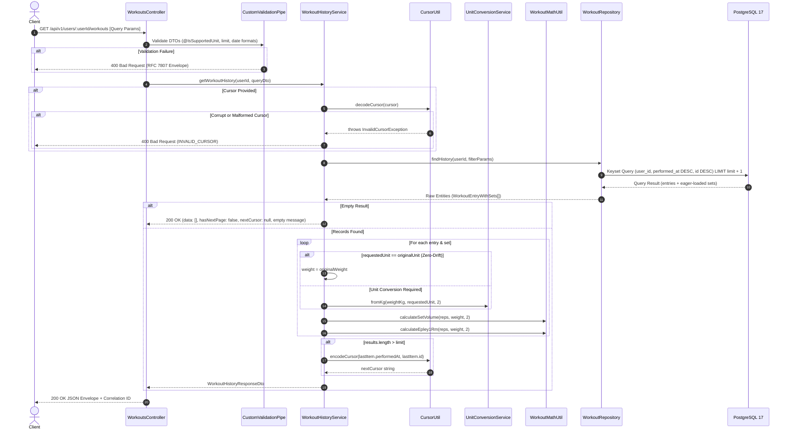

# Implementation Plan: GET /api/v1/users/:userId/workouts

## 1. Overview & Objectives

The goal is to implement the **Get Workout History** endpoint:

- **Route:** `GET /api/v1/users/:userId/workouts`
- **Status Code:** `200 OK`
- **Key Responsibilities:**
  1. Validate and sanitize query parameters (`exerciseName`, `from`, `to`, `muscleGroup`, `unit`, `limit`, `cursor`, `page`).
  2. Enforce date constraints: validate ISO 8601 formatting, normalize date-only boundaries (`YYYY-MM-DD` expands to `00:00:00.000Z` and `23:59:59.999Z`), and verify `from <= to` (throwing `400 VALIDATION_ERROR` on inverted ranges).
  3. Support high-performance keyset pagination ($O(\log N)$) via composite B-Tree index `(user_id, performed_at DESC, id DESC)` using Base64-encoded cursor tokens (`performed_at + id`), with fallback support for standard `page`/`limit` offset pagination.
  4. Leverage PostgreSQL GIN `pg_trgm` index on `exercise_name_norm` for fast case-insensitive partial substring matching (`exerciseName`).
  5. Perform dynamic unit conversion and zero-drift return (if requested unit matches the set's `original_unit`, preserve the exact `original_weight` without floating-point conversion artifacts).
  6. Compute display volume (`reps * weight`) and Epley estimated 1RM (`weight * (1 + reps / 30)`) in requested unit, rounded to 2 decimal places.
  7. Adhere to the empty query rule: return `200 OK` with `data: []`, `hasNextPage: false`, `nextCursor: null`, and a descriptive message when no matching entries exist (never throw `404`).
  8. Handle validation failures and corrupt cursors with standard RFC 7807 error envelopes (`VALIDATION_ERROR`, `UNSUPPORTED_UNIT`, `INVALID_CURSOR`).

---

## 2. Architecture & Data Flow



---

## 3. Step-by-Step Implementation Breakdown

### Phase 1: Keyset Cursor Utility & Validation (`src/common/utils/`)

- [x] **1.1 Cursor Utility (`src/common/utils/cursor.util.ts`):**
  - Define cursor interface:
    ```typescript
    export interface CursorPayload {
      readonly performedAt: string;
      readonly id: string;
    }
    ```
  - Implement `encodeCursor(payload: { performedAt: Date | string; id: string }): string`:
    - Serialize normalized ISO UTC string and entry UUID into Base64 JSON.
  - Implement `decodeCursor(cursor: string): { performedAt: Date; id: string }`:
    - Decode Base64 string safely.
    - Parse JSON and validate presence and formats of `performedAt` (valid date timestamp) and `id` (non-empty string/UUID).
    - Throw `InvalidCursorException` on invalid Base64, JSON parse error, missing fields, or invalid date (`code: INVALID_CURSOR`).
- [x] **1.2 Common Utils Export (`src/common/utils/index.ts`):**
  - Export cursor utility functions for consumption across modules.
- [x] **1.3 Cursor Unit Tests (`src/common/utils/cursor.util.spec.ts`):**
  - Test valid round-trip encode/decode.
  - Test malformed Base64, tampered JSON, missing keys, and invalid timestamp parsing.

---

### Phase 2: DTOs & Strict Validation (`src/modules/workouts/dto/`)

- [ ] **2.1 Workout History Query DTO (`src/modules/workouts/dto/workout-history-query.dto.ts`):**
  - `exerciseName?: string`: Optional trimmed string for case-insensitive partial match (`ILIKE` / `pg_trgm`).
  - `from?: string`: Optional ISO 8601 string. Normalizes date-only string (`YYYY-MM-DD`) to `00:00:00.000Z`.
  - `to?: string`: Optional ISO 8601 string. Normalizes date-only string (`YYYY-MM-DD`) to `23:59:59.999Z`.
  - Date validation: Validate format and ensure `from <= to`. If inverted, throw `ValidationException` (`400 VALIDATION_ERROR`, issue: `"'from' date must be earlier than or equal to 'to' date."`).
  - `muscleGroup?: string`: Optional trimmed string for case-insensitive exact match.
  - `unit?: string`: Optional string, decorated with `@IsSupportedUnit()` (defaults to `'kg'`).
  - `limit?: number`: Optional integer, `@Type(() => Number) @IsInt() @Min(1) @Max(100)` (defaults to `20`).
  - `cursor?: string`: Optional Base64 cursor string.
  - `page?: number`: Optional integer, `@Type(() => Number) @IsInt() @Min(1)`.
- [ ] **2.2 Workout History Response DTOs (`src/modules/workouts/dto/workout-history-response.dto.ts`):**
  - `WorkoutHistorySetDto`:
    - `setNumber`: number
    - `reps`: number
    - `weight`: number (display weight in target unit, rounded to 2 decimals)
    - `unit`: string (target unit)
    - `volume`: number (volume in target unit, rounded to 2 decimals)
    - `estimated1RM`: number (Epley 1RM in target unit, rounded to 2 decimals)
    - `original`: `{ weight: number; unit: string }`
    - `normalizedKg`: number (weight in kg, rounded to 2 decimals)
  - `WorkoutHistoryEntryDto`:
    - `id`: string (UUID)
    - `userId`: string
    - `date`: string (ISO 8601 UTC)
    - `exerciseName`: string
    - `muscleGroup`: string | null
    - `sets`: `WorkoutHistorySetDto[]`
  - `WorkoutHistoryPaginationDto`:
    - `limit`: number
    - `hasNextPage`: boolean
    - `nextCursor`: string | null
  - `WorkoutHistoryMetaDto`:
    - `requestedUnit`: string
    - `message`: string
  - `WorkoutHistoryResponseDto`:
    - `data`: `WorkoutHistoryEntryDto[]`
    - `pagination`: `WorkoutHistoryPaginationDto`
    - `meta`: `WorkoutHistoryMetaDto`
- [ ] **2.3 Export DTOs (`src/modules/workouts/dto/index.ts`):**
  - Export new query and response DTOs.

---

### Phase 3: Data Access & Keyset Query Optimization (`src/modules/workouts/repositories/`)

- [ ] **3.1 Repository Interfaces (`src/modules/workouts/repositories/interfaces/workout-repository.interface.ts`):**
  - Define `FindHistoryFilter`:
    ```typescript
    export interface FindHistoryFilter {
      readonly exerciseName?: string;
      readonly fromDate?: Date;
      readonly toDate?: Date;
      readonly muscleGroup?: string;
      readonly limit: number;
      readonly cursor?: { readonly performedAt: Date; readonly id: string };
      readonly page?: number;
    }
    ```
- [ ] **3.2 Keyset Query Implementation (`src/modules/workouts/repositories/workout.repository.ts`):**
  - Implement `findHistory(userId: string, filter: FindHistoryFilter): Promise<WorkoutEntryWithSets[]>`:
    - Build `where` clause:
      - `userId`
      - `performedAt: { gte: fromDate, lte: toDate }` (if bounds provided)
      - `exerciseNameNorm: { contains: exerciseName.trim().toLowerCase() }` (utilizes `idx_entries_exercise_trgm` GIN index)
      - `muscleGroup: { equals: muscleGroup.trim().toLowerCase(), mode: 'insensitive' }`
      - Keyset cursor condition when cursor is present:
        ```typescript
        OR: [
          { performedAt: { lt: cursor.performedAt } },
          { performedAt: cursor.performedAt, id: { lt: cursor.id } },
        ]
        ```
    - Apply keyset ordering: `orderBy: [ { performedAt: 'desc' }, { id: 'desc' } ]`.
    - Apply pagination limits: `take: limit + 1`.
    - If `cursor` is omitted and `page` is provided: `skip = (page - 1) * limit`.
    - Eager load ordered sets: `include: { sets: { orderBy: { setNumber: 'asc' } } }`.

---

### Phase 4: History Domain Service & Unit Normalization (`src/modules/workouts/services/`)

- [ ] **4.1 Workout History Service (`src/modules/workouts/services/workout-history.service.ts`):**
  - Implement `getWorkoutHistory(userId: string, query: WorkoutHistoryQueryDto): Promise<WorkoutHistoryResponseDto>`:
    - **Parameter Sanitization:**
      - Parse and validate `from` and `to` timestamps (handling date-only start/end of day expansion and `from <= to` constraint).
      - If `cursor` is present, decode via `decodeCursor(cursor)`.
    - **Database Fetch:**
      - Call `workoutRepository.findHistory(userId, filter)`.
    - **Pagination Evaluation:**
      - If `entries.length > limit`: `hasNextPage = true`, visible entries = `entries.slice(0, limit)`, `nextCursor = encodeCursor({ performedAt: lastEntry.performedAt, id: lastEntry.id })`.
      - Else: `hasNextPage = false`, visible entries = `entries`, `nextCursor = null`.
    - **Unit Conversion & Metric Calculations:**
      - For each set:
        - If `targetUnit === set.originalUnit`: `displayWeight = Number(set.originalWeight)` (preserves exact input without conversion drift).
        - Else: `displayWeight = unitConversionService.fromKg(Number(set.weightKg), targetUnit, 2)`.
        - `volume = calculateSetVolume(set.reps, displayWeight, 2)`
        - `estimated1RM = calculateEpley1Rm(set.reps, displayWeight, 2)`
        - `normalizedKg = roundToPrecision(Number(set.weightKg), 2)`
    - **Empty Result Handling:**
      - If `visibleEntries.length === 0`:
        - Return `data: []`, `hasNextPage: false`, `nextCursor: null`, message: `"No workout entries found for the specified filter criteria and date range."`.
      - Else:
        - Return populated entries with message: `"Workout entries retrieved successfully."`.
- [ ] **4.2 Service Registration (`src/modules/workouts/services/index.ts` & `workouts.module.ts`):**
  - Export `WorkoutHistoryService` and register it in `WorkoutsModule` providers and exports.

---

### Phase 5: HTTP Controller & Route Registration (`src/modules/workouts/controllers/`)

- [ ] **5.1 Controller Method (`src/modules/workouts/controllers/workouts.controller.ts`):**
  - Add `@Get()` handler to `WorkoutsController`:
    ```typescript
    @Get()
    @ApiOperation({ summary: 'Get paginated workout history for a user' })
    @ApiParam({ name: 'userId', description: 'Unique identifier of the user' })
    @ApiResponse({ status: HttpStatus.OK, type: WorkoutHistoryResponseDto })
    @ApiResponse({ status: HttpStatus.BAD_REQUEST, type: ErrorResponseDto })
    async getWorkoutHistory(
      @Param('userId') userId: string,
      @Query() query: WorkoutHistoryQueryDto,
    ): Promise<WorkoutHistoryResponseDto>
    ```
  - Structured logging with Pino: log `userId`, `filters`, `returnedCount`, `hasNextPage`, and `durationMs`.

---

### Phase 6: Edge Cases & Scalability Safeguards

- [ ] **6.1 Keyset Pagination at 50,000+ Records:**
  - Guarantees $O(\log N)$ cursor seek using composite B-Tree index `(user_id, performed_at DESC, id DESC)`.
  - Avoids expensive SQL `OFFSET` scans for high-scale paging.
- [ ] **6.2 Corrupt Cursor Protection:**
  - Tampered Base64 strings or non-existent fields immediately raise `400 Bad Request` with `INVALID_CURSOR`.
- [ ] **6.3 Date Boundary Normalization:**
  - Client passing `from=2026-10-01` and `to=2026-10-31` correctly captures all entries within the full month bounds (`00:00:00.000Z` to `23:59:59.999Z`).
  - Inverted ranges (`from > to`) reject with `400 VALIDATION_ERROR`.
- [ ] **6.4 Zero-Drift Guarantee:**
  - Sets logged in `lb` requested back in `lb` return exact `225` rather than `224.99` or `225.01`.
- [ ] **6.5 Empty Results Contract:**
  - Unmatched filters return `200 OK` with an empty array `data: []`—never `404 Not Found`.

---

### Phase 7: Testing Strategy

- [ ] **7.1 Unit Tests (`npm run test`):**
  - `cursor.util.spec.ts`: Test valid encode/decode round-trip, invalid Base64, missing fields, and bad timestamps.
  - `workout-history.service.spec.ts`:
    - Test keyset pagination (`hasNextPage = true/false`, `nextCursor` generation).
    - Test offset pagination fallback when `page` is provided.
    - Test zero-drift preservation vs. cross-unit conversion (`kg` $\leftrightarrow$ `lb`).
    - Test set volume and Epley 1RM calculation in target unit.
    - Test date normalization and inverted range rejection.
    - Test empty result envelope and messaging.
  - `workouts.controller.spec.ts`: Test controller delegation, parameter extraction, and structured logger calls.
- [ ] **7.2 Integration & E2E Tests (`npm run test:e2e`):**
  - `GET /api/v1/users/:userId/workouts` (default pagination and unit).
  - Keyset pagination traversal: verify page 1 `nextCursor` fetches page 2 without duplicates or skips.
  - Filter by partial `exerciseName` matching multiple exercises.
  - Filter by `muscleGroup` and bounded date ranges.
  - Reject unsupported unit (`?unit=grams` $\rightarrow$ `400 UNSUPPORTED_UNIT`).
  - Reject corrupt cursor (`?cursor=invalid_base64` $\rightarrow$ `400 INVALID_CURSOR`).
  - Reject inverted dates (`?from=2026-11-01&to=2026-10-01` $\rightarrow$ `400 VALIDATION_ERROR`).
  - Verify empty response returns `200 OK` with `data: []`.

---

## 4. Definition of Done

1. [ ] `GET /api/v1/users/:userId/workouts` adheres strictly to the response schema and error contracts in `docs/api_endpoints_specification.md`.
2. [ ] Keyset pagination operates efficiently at $O(\log N)$ using composite index `(user_id, performed_at DESC, id DESC)`.
3. [ ] All validation failures return RFC 7807 compliant error envelopes (`VALIDATION_ERROR`, `UNSUPPORTED_UNIT`, `INVALID_CURSOR`).
4. [ ] `npm run lint` passes without errors.
5. [ ] `npm run test` passes with 100% success across all unit test suites.
6. [ ] `npm run test:e2e` passes across all workout history integration test scenarios.
7. [ ] `npm run build` compiles with zero TypeScript errors.

