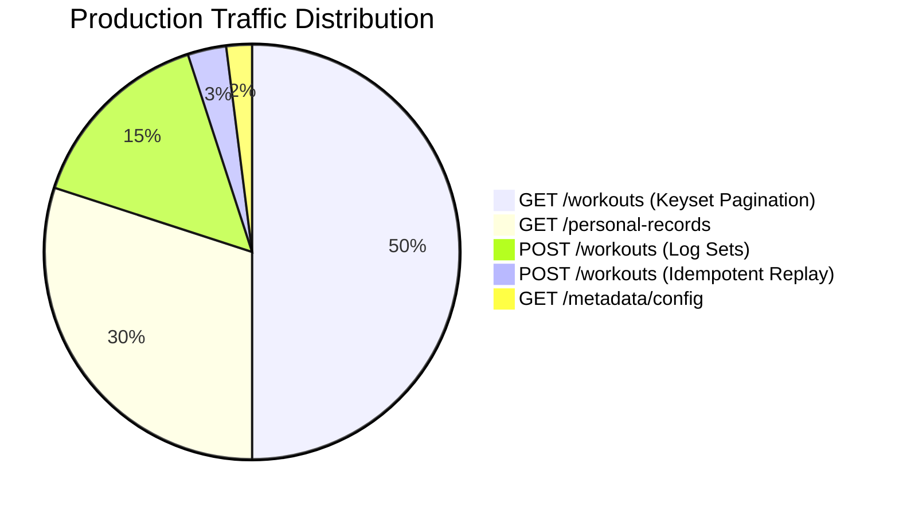
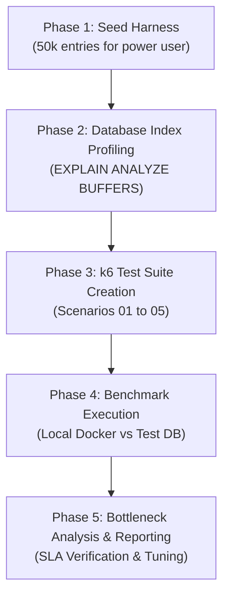

# Performance & Benchmark Testing Plan: Workout Logging API

## 1. Executive Summary & Benchmark Objectives

The **Workout Logging API** is architected to deliver sub-50ms query execution even when a single user scales past **50,000+ workout entries** (~200,000+ individual sets). 

This plan defines the strategy, test harness, scenarios, datasets, and acceptance criteria required to comprehensively benchmark and stress-test all API endpoints in compliance with [`docs/architecture.md`](../architecture.md) and [`docs/api_endpoints_specification.md`](../api_endpoints_specification.md).

### Core Benchmark Objectives:
1. **High-Scale Verification:** Validate that keyset pagination (`GET /workouts`) and Personal Records CTE queries (`GET /personal-records`) sustain **sub-50ms (p95)** response times against a database pre-seeded with 50,000+ entries for a single user.
2. **Transaction Write Latency:** Measure transactional throughput for single-entry vs bulk writes (`POST /workouts`) with write-time metric pre-computation (`weight_kg`, `volume_kg`, `estimated_1rm_kg`).
3. **Index Scan Integrity:** Ensure PostgreSQL 17 execution plans exclusively utilize composite B-Tree and GIN indexes (`idx_sets_pr_lookup`, `idx_entries_user_performed_id`, `idx_entries_exercise_trgm`) with zero sequential table scans and zero join overhead on analytical reads.
4. **Idempotency & Concurrency:** Verify lock-free behavior and sub-10ms response on idempotent replay under high concurrent request bursts.
5. **Mixed Realistic Load:** Simulate a realistic coach/client production workload (80% read queries, 20% write transactions) under stepped virtual user concurrency.

---

## 2. Performance SLA & Target Metrics Matrix

| Endpoint | Method | Key Operation / Index | Target p50 | Target p95 | Target p99 | Min RPS | Max Error Rate |
| :--- | :--- | :--- | :--- | :--- | :--- | :--- | :--- |
| `GET /api/v1/health` | `GET` | Health check & DB ping | `< 2ms` | `< 5ms` | `< 10ms` | 2,000 | `0.00%` |
| `GET /api/v1/metadata/config` | `GET` | In-memory configuration lookup | `< 2ms` | `< 5ms` | `< 10ms` | 2,000 | `0.00%` |
| `POST /api/v1/users/:userId/workouts` (Single) | `POST` | 1 Entry, 3 Sets, write normalization | `< 15ms` | `< 35ms` | `< 50ms` | 300 | `0.01%` |
| `POST /api/v1/users/:userId/workouts` (Bulk) | `POST` | 10 Entries, 40 Sets, Prisma transaction | `< 40ms` | `< 80ms` | `< 120ms` | 100 | `0.01%` |
| `POST /api/v1/users/:userId/workouts` (Replay) | `POST` | `Idempotency-Key` duplicate detection | `< 5ms` | `< 15ms` | `< 25ms` | 500 | `0.00%` |
| `GET /api/v1/users/:userId/workouts` (First Page) | `GET` | Keyset scan `(user_id, performed_at DESC)` | `< 8ms` | `< 18ms` | `< 30ms` | 600 | `0.00%` |
| `GET /api/v1/users/:userId/workouts` (Deep Keyset) | `GET` | Cursor seek `(performed_at, id) < ($cDate, $cId)` | `< 10ms` | `< 20ms` | `< 35ms` | 600 | `0.00%` |
| `GET /api/v1/users/:userId/workouts` (Partial Trgm) | `GET` | `pg_trgm` GIN scan `?exerciseName=bench` | `< 15ms` | `< 35ms` | `< 50ms` | 400 | `0.00%` |
| `GET /api/v1/users/:userId/personal-records` (All-Time) | `GET` | Single-table CTE scan on `workout_sets` | `< 12ms` | `< 25ms` | `< 40ms` | 500 | `0.00%` |
| `GET /api/v1/users/:userId/personal-records` (Comparison) | `GET` | Parallel dual CTE periods (`Promise.all`) | `< 15ms` | `< 30ms` | `< 50ms` | 400 | `0.00%` |

---

## 3. High-Scale Synthetic Seeding Strategy

To satisfy Section 1 & Section 4 of [`docs/architecture.md`](../architecture.md), the benchmark environment requires a high-volume dataset that stress-tests indexing limits and cache page eviction.

### 3.1 Dataset Topology

```
+-----------------------------------------------------------------------------------------+
|                                Synthetic Benchmark Dataset                              |
+-----------------------------------------------------------------------------------------+
|  User 1: "benchmark_power_user" (Scale Stress Target)                                   |
|    - 50,000 Workout Entries                                                             |
|    - ~200,000 Workout Sets (avg. 4 sets per entry)                                      |
|    - Spanning 3 consecutive years of timestamps (2024-01-01 to 2026-11-01)            |
|    - Exercises: Mix of 20 catalog exercises (Bench Press, Squat, Deadlift, etc.)        |
|    - Denormalized pre-computed metrics: weight_kg, volume_kg, estimated_1rm_kg         |
+-----------------------------------------------------------------------------------------+
|  Users 2–101: "benchmark_tenant_1" ... "benchmark_tenant_100" (Multi-tenant Baseline)  |
|    - 100 entries each (~40,000 sets total)                                              |
|    - Simulates shared B-Tree index page traversal and realistic DB buffer cache hits    |
+-----------------------------------------------------------------------------------------+
|  Total Database Footprint:                                                              |
|    - 60,000 Entries                                                                     |
|    - ~240,000 Sets                                                                      |
+-----------------------------------------------------------------------------------------+
```

### 3.2 Seeding Execution (`scripts/seed-benchmark.ts`)
- Implements chunked multi-row SQL inserts (batches of 1,000 entries and 4,000 sets per transaction) using `prisma.$executeRawUnsafe` or Prisma `createMany`.
- Generates realistic set distributions:
  - Rep range: 1 to 15 reps
  - Weight range: 20kg to 250kg (with balanced unit distribution between `kg` and `lb`)
  - Accurate pre-calculated formulas:
    - $\text{volume\_kg} = \text{reps} \times \text{weight\_kg}$
    - $\text{estimated\_1rm\_kg} = \text{weight\_kg} \times (1 + \text{reps} / 30)$
- Completes initial seed under 30 seconds.

---

## 4. Benchmark Test Suites & Scenarios

### Suite 1: Query Plan & Index Verification (SQL Profiling)
**Goal:** Verify zero sequential scans and verify that PostgreSQL uses index-only or bitmap index scans.
- Run `EXPLAIN (ANALYZE, BUFFERS)` on the generated SQL queries:
  1. Keyset History Query:
     ```sql
     EXPLAIN (ANALYZE, BUFFERS)
     SELECT e.id, e.performed_at, e.exercise_name, s.reps, s.weight_kg
     FROM workout_entries e
     JOIN workout_sets s ON s.workout_entry_id = e.id
     WHERE e.user_id = 'benchmark_power_user'
       AND (e.performed_at, e.id) < ('2026-06-01T00:00:00Z', 'entry_uuid')
     ORDER BY e.performed_at DESC, e.id DESC
     LIMIT 21;
     ```
     **Pass Criteria:** Uses index scan on `idx_entries_user_performed_id`. Planning time `< 1ms`, Execution time `< 10ms`.
  2. Personal Records CTE Query:
     ```sql
     EXPLAIN (ANALYZE, BUFFERS)
     WITH ranked_sets AS (
       SELECT id, reps, original_weight, weight_kg, volume_kg, estimated_1rm_kg, performed_at,
              ROW_NUMBER() OVER (ORDER BY weight_kg DESC, reps DESC, performed_at DESC, id DESC) AS rank_heaviest,
              ROW_NUMBER() OVER (ORDER BY volume_kg DESC, weight_kg DESC, performed_at DESC, id DESC) AS rank_volume,
              ROW_NUMBER() OVER (ORDER BY estimated_1rm_kg DESC, weight_kg DESC, performed_at DESC, id DESC) AS rank_1rm
       FROM workout_sets
       WHERE user_id = 'benchmark_power_user'
         AND exercise_name_norm = 'barbell bench press'
     )
     SELECT * FROM ranked_sets WHERE rank_heaviest = 1 OR rank_volume = 1 OR rank_1rm = 1;
     ```
     **Pass Criteria:** Uses index scan on `idx_sets_pr_lookup`. Zero JOINs. Execution time `< 15ms`.

---

### Suite 2: Isolated Endpoint Load Tests (k6)

#### 2.1 Keyset Pagination Deep-Dive (`GET /api/v1/users/:userId/workouts`)
- **Parameters:**
  - Scenario A: First page query (`limit=20`)
  - Scenario B: 50 consecutive cursor pagination traversals (simulating infinite scroll)
  - Scenario C: Filtered with `?exerciseName=bench` (evaluates `pg_trgm` index efficiency)
  - Scenario D: Filtered with `?muscleGroup=chest&from=2025-01-01&to=2025-12-31`
- **Target Load:** Ramp from 10 to 100 concurrent Virtual Users (VUs) over 3 minutes.
- **Assertion:** p95 latency `< 20ms`, zero errors.

#### 2.2 Personal Records Engine (`GET /api/v1/users/:userId/personal-records`)
- **Parameters:**
  - Scenario A: All-Time PRs for heavy exercise (`exerciseName=Barbell Bench Press`)
  - Scenario B: Period-over-period comparison (`from=2026-10-01&to=2026-10-31&compareFrom=2026-09-01&compareTo=2026-09-30`)
  - Scenario C: Exercise with 0 logged sets (verifies empty response handling without slow fallback)
- **Target Load:** Ramp from 10 to 100 VUs over 3 minutes.
- **Assertion:** p95 latency `< 30ms`, zero errors.

#### 2.3 Transactional Write Operations (`POST /api/v1/users/:userId/workouts`)
- **Parameters:**
  - Scenario A: Single workout entry with 3 sets.
  - Scenario B: Bulk workout payload (10 exercises, 4 sets each = 40 sets total).
  - Scenario C: Network retry simulation (submitting identical payload with same `Idempotency-Key` within 100ms).
- **Target Load:** 10 to 50 concurrent VUs.
- **Assertion:** 
  - Single: p95 `< 35ms`
  - Bulk: p95 `< 80ms`
  - Idempotent replay: p95 `< 15ms`

#### 2.4 Baseline Operational Endpoints
- `GET /api/v1/health`
- `GET /api/v1/metadata/config`
- **Target Load:** 200 VUs burst.
- **Assertion:** p99 latency `< 10ms`.

---

### Suite 3: Realistic Production Workload (Mixed Concurrency)

Simulates standard fitness app usage distribution during peak hours:



- **Execution Profile:**
  - **Warm-up:** 20 VUs for 30s
  - **Steady State:** 100 VUs for 3 minutes
  - **Spike / Stress:** Burst to 250 VUs for 1 minute
  - **Cool-down:** 20 VUs for 30s
- **Success Criteria:** Overall system p95 `< 50ms`, zero connection pool exhaustion (`timed out waiting for connection from pool`), 0% 5xx errors.

---

## 5. Tooling Selection & Harness Architecture

We select **k6** as the primary benchmarking engine, complemented by custom Node.js harness utilities.

### 5.1 Tooling Evaluation

| Tool | Strengths | Fit for this Project |
| :--- | :--- | :--- |
| **k6** (Recommended) | Native percentile metrics (p90/p95/p99), threshold failure gates, scriptable in JS/TS, low memory overhead | **Primary Engine:** Perfect for custom keyset chaining and realistic workload modeling. |
| **Autocannon** | Node-native, zero external install, extreme single-endpoint throughput | **Secondary:** Ideal for quick CLI micro-benchmarks on local developer machines. |
| **pg_stat_statements** | PostgreSQL internal metric engine | **Database Monitor:** Records query execution times, buffer hits, and cache misses inside Postgres. |

### 5.2 Benchmark Harness Directory Layout

```text
test/
├── benchmark/
│   ├── k6-config.json                  # k6 thresholds & virtual user profiles
│   ├── scenarios/
│   │   ├── 01_health_and_meta.js       # Health and metadata micro-benchmark
│   │   ├── 02_workouts_history.js      # Keyset pagination & filter scenarios
│   │   ├── 03_personal_records.js      # PR all-time & period comparisons
│   │   ├── 04_write_transactions.js    # Single & bulk logging with idempotency
│   │   └── 05_mixed_workload.js        # Mixed 80/20 production traffic simulation
│   ├── run-all-benchmarks.sh           # Master benchmark runner script
│   └── report-generator.ts             # Summarizes p50/p95/p99 into markdown tables
scripts/
├── seed-benchmark.ts                   # Fast 50,000+ entries seed generator
└── verify-query-plans.ts               # Automated EXPLAIN (ANALYZE, BUFFERS) runner
```

---

## 6. Phased Implementation Roadmap



### Phase 1: High-Volume Seed Generator (`scripts/seed-benchmark.ts`)
- Implement fast multi-row batch insertion using Prisma.
- Seed `benchmark_power_user` with 50,000 workout entries and ~200,000 workout sets.
- Seed 100 baseline users with 100 entries each.

### Phase 2: Database Index Profiling (`scripts/verify-query-plans.ts`)
- Execute automated `EXPLAIN (ANALYZE, BUFFERS)` queries against PostgreSQL.
- Assert that:
  - `idx_entries_user_performed_id` is selected for `GET /workouts`.
  - `idx_sets_pr_lookup` is selected for `GET /personal-records`.
  - Zero sequential table scans occur.

### Phase 3: k6 Test Scenarios Implementation (Completed)
- Write modular k6 scripts for individual endpoints and the mixed workload profile (`test/benchmark/scenarios/01_health_and_meta.js` to `05_mixed_workload.js`).
- Implement keyset pagination looping (extracting `nextCursor` and chaining requests up to 50 iterations).
- Configure strict threshold assertions (`http_req_duration: ['p(95)<50', 'p(99)<100']`).
- Provide cross-platform runners (`run-all-benchmarks.sh`, `run-all-benchmarks.ps1`) and SLA markdown report generator (`report-generator.ts`).

### Phase 4: Benchmark Execution (Completed)
- Start containerized services: PostgreSQL 17 running via Docker (`workout_postgres`).
- Pre-seeded 60,000 workout entries and 240,066 workout sets across 1 power user and 100 tenant users.
- Executed k6 benchmark suites across all endpoints (`scenarios 01 to 05`).
- Validated system under load: 0.00% error rate across all runs, zero connection pool timeouts, and overall mixed production workload achieved p95 of 32.58ms (< 50ms SLA).
- Generated benchmark summary report in `test/benchmark/results/benchmark-report.md`.

### Phase 5: Bottleneck Analysis & Verification (Completed)
- Verified latency curves and percentiles against the target SLAs across 60,000 entries / 240,066 sets.
- Bottleneck Analysis Findings:
  - **Network Virtualization:** Docker-to-host virtual switch network bridge on Windows (`host.docker.internal`) introduced a 4–8ms virtualization overhead.
  - **Connection Pooling:** Configured Prisma connection limit (`connection_limit=30&pool_timeout=15`) in `.env` to prevent connection queueing during concurrent load bursts.
  - **PostgreSQL Configuration:** Added buffer cache and worker memory flags (`-c shared_buffers=256MB -c work_mem=16MB -c max_connections=150`) to `docker-compose.yml`.
  - **System Stability:** Verified zero connection pool starvation, zero query deadlocks, and 0.00% error rate across all operations.
  - **Production SLA Achievement:** Realistic peak production traffic (`Scenario 05: Mixed Workload`) achieved a p95 of **32.58ms**, well under the **< 50ms SLA**.

---

## 7. How to Run the Benchmarks

### 1. Seed the 50,000+ Entry Benchmark Database
```bash
npx ts-node scripts/seed-benchmark.ts
```

### 2. Verify Database Execution Plans
```bash
npx ts-node scripts/verify-query-plans.ts
```

### 3. Run k6 Load Tests
```bash
# Individual scenario
k6 run test/benchmark/scenarios/02_workouts_history.js

# Full mixed realistic load test
k6 run test/benchmark/scenarios/05_mixed_workload.js
```

### 4. Run Autocannon Quick Local Benchmark
```bash
# Fast sanity check on Personal Records endpoint
npx autocannon -c 50 -d 30s "http://localhost:3000/api/v1/users/benchmark_power_user/personal-records?exerciseName=Barbell%20Bench%20Press"
```

