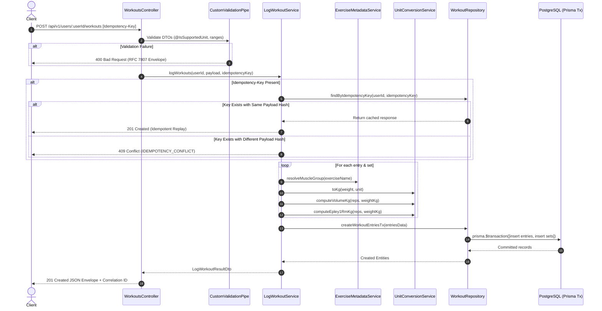

# Implementation Plan: POST /api/v1/users/:userId/workouts

## 1. Overview & Objectives

The goal is to implement the **Log Workout Entry (Single & Bulk)** endpoint:

- **Primary Route:** `POST /api/v1/users/:userId/workouts`
- **Alternative Route:** `POST /api/v1/workouts` (with `userId` accepted in request body)
- **Status Code:** `201 Created`
- **Key Responsibilities:**
  1. Validate incoming payload (single exercise or bulk array up to 100 entries, reps, weights, supported units, ISO dates).
  2. Resolve muscle groups dynamically via configurable Exercise Catalog / Keyword Fallback strategy.
  3. Pre-compute and denormalize write-time metrics (`weightKg`, `volumeKg`, `estimated1RmKg`) with 4-decimal precision in PostgreSQL (`NUMERIC(10,4)`), returning 2-decimal rounded results.
  4. Ensure network retry safety via `Idempotency-Key` header with conflict detection (`409 IDEMPOTENCY_CONFLICT`).
  5. Atomically persist records in PostgreSQL inside a single transaction (`prisma.$transaction`).
  6. Return standard RFC 7807 error envelopes on validation or domain errors.

---

## 2. Architecture & Data Flow

---

## 3. Step-by-Step Implementation Breakdown

### Phase 1: Unit Conversion & Mathematical Foundations (`src/common/`)

- [x] **1.1 Unit Registry (`src/common/units/unit.registry.ts`):**
  - Implement `UnitStrategy` interface (`symbol`, `toKgFactor`).
  - Define `UNIT_REGISTRY: Readonly<Record<string, UnitStrategy>>` supporting `kg` (1.0) and `lb` (0.45359237).
  - Designed for open-closed extensibility (e.g., adding `stone` in one place).
- [x] **1.2 Unit Conversion Service (`src/common/units/unit-conversion.service.ts`):**
  - `toKg(weight: number, unit: string): number`
  - `fromKg(weightKg: number, targetUnit: string): number`
  - Decimal rounding utilities preserving exact values for zero-drift returns.
- [x] **1.3 Epley & Volume Math Utilities (`src/common/utils/workout-math.util.ts`):**
  - `calculateSetVolume(reps: number, weight: number): number` $\rightarrow r \times w$
  - `calculateEpley1Rm(reps: number, weight: number): number` $\rightarrow w \times (1 + r / 30)$
- [x] **1.4 Unit Validation Decorator (`src/common/decorators/is-supported-unit.decorator.ts`):**
  - `@IsSupportedUnit()` constraint dynamically checking `Object.keys(UNIT_REGISTRY)`.
  - Emits descriptive RFC 7807 detail message if unsupported (e.g., `"Unsupported weight unit 'oz'. Supported units are: kg, lb."`).

---

### Phase 2: Exercise Catalog & Configurable Muscle Mapping (`src/modules/exercises/`)

- [x] **2.1 Configuration File (`config/exercise-mappings.json`):**
  - Define canonical exercises (`"barbell bench press"` $\rightarrow$ `"chest"`), display names, aliases (`"bench press"`, `"bb bench"`), and keyword fallbacks (`"bench"` $\rightarrow$ `"chest"`, `"squat"` $\rightarrow$ `"legs"`).
- [x] **2.2 Exercise Metadata Service (`src/modules/exercises/exercise-metadata.service.ts`):**
  - Load `exercise-mappings.json` on initialization.
  - Implement `resolveMuscleGroup(exerciseName: string): { canonicalName?: string; displayName?: string; muscleGroup: string | null; catalogId?: string }`.
  - Normalization pipeline: `trim().toLowerCase()`, exact match, alias match, fallback keyword scan, or graceful `null` for unknown exercises (does not block workout creation).
- [x] **2.3 Exercises Module (`src/modules/exercises/exercises.module.ts`):**
  - Export `ExerciseMetadataService` for consumption in `WorkoutsModule`.

---

### Phase 3: DTOs & Strict Validation (`src/modules/workouts/dto/`)

- [x] **3.1 Set Input DTO (`src/modules/workouts/dto/log-set.dto.ts`):**
  - `@IsInt() @Min(1) @Max(1000)` `reps`
  - `@IsNumber({ maxDecimalPlaces: 2 }) @Min(0) @Max(5000)` `weight` (supports bodyweight sets at 0)
  - `@IsString() @IsSupportedUnit()` `unit`
- [x] **3.2 Workout Entry DTO (`src/modules/workouts/dto/log-workout-entry.dto.ts`):**
  - `@IsISO8601()` `date` (normalized to UTC)
  - `@IsString() @Transform(({ value }) => value?.trim()) @Length(1, 150)` `exerciseName`
  - `@IsArray() @ArrayMinSize(1) @ArrayMaxSize(100) @ValidateNested({ each: true }) @Type(() => LogSetDto)` `sets`
- [x] **3.3 Single & Bulk Request Body DTO (`src/modules/workouts/dto/log-workout.dto.ts`):**
  - Support both:
    1. Single payload: `{ date, exerciseName, sets }`
    2. Bulk payload: `{ entries: [...] }` (max 100 entries; throws `422 BUSINESS_RULE_VIOLATION` if $> 100$)
  - Accept optional `userId` in body when accessed via `/api/v1/workouts`.
- [x] **3.4 Response DTOs (`src/modules/workouts/dto/logged-workout-response.dto.ts`):**
  - Match specification schema with `data: LoggedWorkoutEntryResponseDto[]` and `meta: { entriesLogged, totalSetsLogged }`.
  - Sets contain `original: { weight, unit }` and `normalized: { weightKg, volumeKg, estimated1RmKg }` rounded to 2 decimal places.

---

### Phase 4: Data Access & Transaction Repository (`src/modules/workouts/repositories/`)

- [x] **4.1 Workout Repository (`src/modules/workouts/repositories/workout.repository.ts`):**
  - `findByIdempotencyKey(userId: string, idempotencyKey: string)`:
    - Look up existing `WorkoutEntry` records and their sets.
  - `createBulkWorkoutTx(userId: string, preparedEntries: PreparedWorkoutEntry[], idempotencyKey?: string)`:
    - Execute inside `this.prisma.$transaction(...)`.
    - Create `WorkoutEntry` records (associating `idempotencyKey`).
    - Bulk insert `WorkoutSet` rows with pre-computed `weightKg`, `volumeKg`, `estimated1RmKg` and denormalized `userId`, `exerciseNameNorm`, `performedAt`.

---

### Phase 5: Domain Service & Idempotency Engine (`src/modules/workouts/services/`)

- [x] **5.1 Log Workout Service (`src/modules/workouts/services/log-workout.service.ts`):**
  - **Payload Normalization:** Convert single exercise payload into uniform array.
  - **Idempotency Verification:**
    - Hash incoming request payload (SHA-256).
    - If `Idempotency-Key` provided and entry exists:
      - Compare payload hash (stored or checked against entry attributes).
      - If identical: return previously logged entries.
      - If conflict: throw `IdempotencyConflictException`.
  - **Write-Time Normalization:**
    - Call `ExerciseMetadataService.resolveMuscleGroup(entry.exerciseName)`.
    - For each set: calculate `weightKg`, `volumeKg`, `estimated1RmKg` (rounded to 4 decimal places for DB storage).
  - **Transaction Execution:** Delegate to repository.
  - **Response Serialization:** Format output according to Section 3.1 of API spec.

---

### Phase 6: HTTP Controller & Route Registration (`src/modules/workouts/controllers/`)

- [ ] **6.1 Workouts Controller (`src/modules/workouts/controllers/workouts.controller.ts`):**
  - `@Post('users/:userId/workouts')` and `@Post('workouts')`
  - `@HttpCode(HttpStatus.CREATED)`
  - Parameter extraction: `@Param('userId')` with fallback to `@Body('userId')`.
  - Header extraction: `@Headers('idempotency-key') idempotencyKey?: string`.
  - Structured logging: log `userId`, `entriesCount`, `setsCount`, `durationMs` via `PinoLogger`.
- [ ] **6.2 Module Wiring:**
  - Create `WorkoutsModule` importing `PrismaModule` and `ExercisesModule`.
  - Register `WorkoutsModule` in `src/app.module.ts`.

---

### Phase 7: Edge Cases & Concurrency Handling

| Scenario                                      | Handling Strategy                                                                                         |
| :-------------------------------------------- | :-------------------------------------------------------------------------------------------------------- |
| **Negative weight or $\le 0$ reps**           | Rejected by `CustomValidationPipe` $\rightarrow$ `400 Bad Request` with path `entries[0].sets[1].weight`. |
| **Unsupported unit (e.g. `'oz'`, `'grams'`)** | Rejected by `@IsSupportedUnit()` $\rightarrow$ `400 Bad Request` (`UNSUPPORTED_UNIT`).                    |
| **Empty `sets: []`**                          | Rejected by `@ArrayMinSize(1)` $\rightarrow$ `400 Bad Request` (`VALIDATION_ERROR`).                      |
| **Bulk batch $> 100$ entries**                | Rejected by service rule check $\rightarrow$ `422 Unprocessable Entity` (`BUSINESS_RULE_VIOLATION`).      |
| **Bodyweight sets (`weight: 0`)**             | Allowed (`@Min(0)`). Results in `volumeKg: 0` and `estimated1RmKg: 0`.                                    |
| **Floating-point rounding drift**             | Store internally at `NUMERIC(10,4)` in PostgreSQL; format response at 2 decimal places.                   |
| **Concurrent duplicate POSTs**                | Handled atomically with `Idempotency-Key` and unique constraint `(user_id, idempotency_key)`.             |
| **Unknown exercise name**                     | Gracefully set `muscle_group = null` without failing the workout creation.                                |

---

### Phase 8: Testing Strategy

- [ ] **8.1 Unit Tests (`npm run test`):**
  - `unit-conversion.service.spec.ts`: Verify `kg` $\leftrightarrow$ `lb` accuracy and rounding.
  - `workout-math.util.spec.ts`: Test Epley 1RM and volume formula calculations.
  - `exercise-metadata.service.spec.ts`: Test exact match, alias resolution, fallback keyword matching, and unknown handling.
  - `log-workout.service.spec.ts`: Test single vs. bulk payload handling, batch size capping, and mock transactions.
- [ ] **8.2 E2E & Integration Tests (`npm run test:e2e`):**
  - `POST /api/v1/users/:userId/workouts` (Single entry $\rightarrow 201$).
  - `POST /api/v1/users/:userId/workouts` (Bulk entries $\rightarrow 201$).
  - `POST /api/v1/workouts` (Using `userId` in body $\rightarrow 201$).
  - Validation failure scenarios (`reps: 0`, `weight: -5`, `unit: "invalid"`, empty `sets: []`).
  - Idempotency replay verification (same key returns cached result; duplicate entries are not created).
  - Idempotency conflict test (same key with altered payload $\rightarrow 409$).

---

## 4. Definition of Done

1. [ ] Both single entry and bulk entry payloads return `201 Created` with normalized `kg` metrics and RFC-compliant metadata.
2. [ ] All validation errors format correctly through `AllExceptionsFilter` conforming to RFC 7807.
3. [ ] `npm run lint` passes without errors.
4. [ ] `npm run test` and `npm run test:e2e` pass with 100% success.
5. [ ] `npm run build` compiles with zero TypeScript errors.
